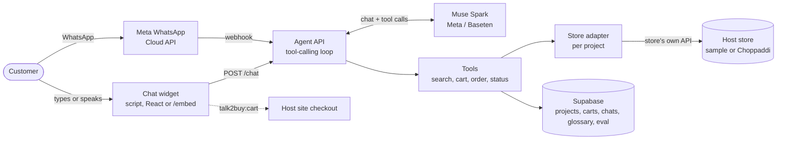

# Talk2Buy

**Order anything the way you'd ask a friend.** Talk2Buy is an AI shopping assistant for local
shops that speaks English and Nigerian Pidgin, typed or spoken. Tell it what you need, your budget
and how fast you need it. It finds real products from nearby shops, builds your cart, and sends
it to the store's own checkout or places the order for you to confirm. On the web or on WhatsApp.

> "Abeg find me jollof wey no pass 3k, make e reach me before 2pm."
>
> "I need 5kg rice, 2 tins of tomato paste, one carton of Indomie and detergent."

Built for the **Meta Global AI Developer Hackathon 2026** (Indie Developer Track) by Koxy Builds.

**Live demo:** [talk2buy.vercel.app](https://talk2buy.vercel.app)

> 🚧 The demo video will be added before submission.

## How it works

- **Agent API** (`services/agent`): a tool-calling loop on Meta models that turns a chat message
  into product searches, carts and orders. Also transcribes voice clips, and answers WhatsApp
  messages through Meta's webhook (`/whatsapp`).
- **Tools API** (`services/tools`): the only service that reads product, order and payment data,
  through a store adapter chosen per project (see [Stores](#stores)).
- **Chat widget** (`packages/widget`): script tag, React component, or the hosted `/embed` page
  that host sites open in a dialog.
- **Demo app** (`apps/demo`): the landing page and live demo, the `/embed` page, and `/contact`
  (a form that emails the team).
- **Evaluation** (`eval`): 50 test requests in English and Pidgin, scored per model.

## Models

| Role | Model | Runs on |
|---|---|---|
| Core agent | Muse Spark 1.3 | Meta Model API |
| Comparison and fallback | Muse Wonder 1.0 | Meta Model API |
| Comparison (open weights) | Muse Spark Open | Baseten |
| Voice input | Muse Spark Open (audio input) | Baseten |

The live demo currently runs on **Muse Spark Open** (`AGENT_MODEL=spark-open`). The Meta Model API
returns `model_not_found` for requests from our host (Render), although the same key works from a
home connection; we have reported this to Meta. All three models score 100% on the eval and use the
same OpenAI-compatible API, so switching back is one environment variable.

Voice clips also go to Muse Spark Open, which accepts audio. Muse Voice Transcribe is offered only
as a realtime connection on the Meta Model API, which our host can't reach.

## Safety by design

- Prices and totals come only from the store. The eval checks every ₦ amount in a reply
  against that turn's tool results.
- The model cannot confirm an order. Only the customer's confirm button can, or, for stores with
  their own checkout, the customer pays there after saying yes to the exact items and prices.
- The agent can read payment status but cannot start or move payments.
- Phone numbers and addresses never reach the model.
- Unknown Pidgin or slang is looked up in a glossary, then the web, and the lookup returns a
  meaning only, never products or prices.

## Stores

Each project row in `projects` names its store adapter (`adapter`) and that store's settings
(`adapter_config`). Adapters read a store's existing API as it is; the store changes nothing.

| Adapter | Store | Status |
|---|---|---|
| `sample` | Made-up shops in 7 Nigerian cities, with real opening hours and simulated payments | Full ordering |
| `choppaddi` | [Choppaddi](https://www-testnet.choppaddi.cloud) testnet, config `{"apiUrl": …}` | Search, cart and hand-off to Choppaddi's own checkout, with product variants |

Adapters say whether their times are delivery or preparation (`etaKind`) and how orders happen:

- **Ordering in the chat** (default): pending orders the customer confirms with a button.
- **Hand-off** (`checkout: "handoff"`): after the customer says yes, the re-checked cart is posted
  to the host page as `talk2buy:cart`, one message per shop, for the store's own checkout. No API
  keys or customer tokens are shared.
- **Not yet** (`ordersConnected: false`): the agent points customers to the website's checkout.

Onboarding another store on a supported platform is a new `projects` row.

## Evaluation

50 requests (half in Pidgin: food, groceries, shopping lists, payment and delivery questions),
scored on tool choice, filters, cart contents, safety behaviour and invented prices.

| Model | Oct 29 | Nov 3 | Median reply (Nov 3) |
|---|---|---|---|
| Muse Spark 1.3 (default) | 100% | not run | 4.8s (Oct 29) |
| Muse Wonder | 100% | not run | 8.0s (Oct 29) |
| Muse Spark Open (live demo) | 100% | 100% | 5.1s |

The Nov 3 run re-checks the live model after the hand-off, ranking and prompt changes, on Baseten
to save Meta credits. Its first try scored 98%: one reply worked out "₦980 over your budget"
itself, which counts as an invented price. The prompt now says to give the total instead, and
the re-run scored 100%. Results are in `eval/results/`.

Run it with `pnpm eval` (options: `--models spark,wonder`, `--only F01,G13`).

## Getting started

Requires Node 20+ and pnpm 9.

    pnpm install
    cp .env.example .env   # add your Meta, Baseten and Supabase keys
    pnpm ping              # check that both models respond

Run the agent and its checks:

    pnpm --filter @talk2buy/agent dev          # chat API on http://localhost:8787
    pnpm --filter @talk2buy/tools try-search   # search tools against the sample store
    pnpm --filter @talk2buy/tools try-cart     # carts, orders and confirm
    pnpm --filter @talk2buy/agent try-agent    # eval requests through the agent
    pnpm --filter @talk2buy/agent try-order    # a full chat order, list to confirmed
    pnpm --filter @talk2buy/widget build       # build the widget the demo uses (again after widget changes)
    pnpm --filter @talk2buy/demo dev           # demo page on http://localhost:3000 (agent must be running)

Add the widget to any site with a script tag (build it with `pnpm --filter @talk2buy/widget build`):

    

The script isn't hosted yet; businesses embed the hosted page below.

Or in React:

    import { Talk2BuyWidget } from "@talk2buy/widget/react";
    <Talk2BuyWidget projectId="sample" apiUrl="http://localhost:8787" areas={["Lagos", "Abuja"]} />

Options: `themeColor` (`data-theme-color`), `theme` (`data-theme`: `light` or `dark`, default light),
`language` (`data-language`: `en` or `pcm`), a fixed `area` or a list of `areas` to choose from,
`voice` (`data-voice`: a mic button; the message is transcribed and sent, and the reply starts by
checking what was heard) and `feedback` (`data-feedback`: thumbs up/down under each reply).
The widget runs in a shadow root, so it doesn't clash with the host site's styles.

### Embedding in a frame

Host sites can also open the hosted chat page in a frame (a popup, side panel or page), the way
hosted KYC and checkout pages are embedded. Only sites in the project's `allowed_domains` can frame
it. The page reports to the host with `postMessage`: `talk2buy:ready`, `talk2buy:close`,
`talk2buy:orders` (orders waiting for the customer's Confirm), `talk2buy:confirmed`, and
`talk2buy:cart` (for stores using their own checkout: one per shop, with `vendorId`,
`vendorSlug` and `items`).

    <button id="order-ai">Order with AI</button>
    <dialog id="talk2buy" style="padding:0;border:0;border-radius:20px;
            width:min(420px,100vw);height:min(680px,100dvh)">
      <iframe src="https://talk2buy.vercel.app/embed?project=YOUR_PROJECT&voice&feedback"
              allow="microphone" style="width:100%;height:100%;border:0"></iframe>
    </dialog>
    

URL settings: `project`, `theme` (`dark`), `language` (`pcm`), `color`, `area` or `areas`
(comma-separated), `voice` and `feedback`. `allow="microphone"` is needed for voice: browsers block
the microphone in a frame from another domain unless the host grants it.

Full steps for businesses (what we need from them, settings, events, testing):
[docs/BUSINESS_INTEGRATION.md](docs/BUSINESS_INTEGRATION.md).

## Deployment

**Agent API (Render, Node):**

- Root directory: repo root (the agent uses the `@talk2buy/tools` workspace package)
- Build: `corepack pnpm install --frozen-lockfile`
- Start: `corepack pnpm --filter @talk2buy/agent exec tsx src/server.ts`
- Environment: the keys from `.env.example`, plus `AGENT_PORT=10000`, `NODE_VERSION=22`,
  `COREPACK_ENABLE_DOWNLOAD_PROMPT=0`, `EMBED_HOSTS=talk2buy.vercel.app` (the domain serving
  `/embed`) and, for now, `AGENT_MODEL=spark-open`
- Region: Frankfurt, close to the Supabase database (London)

**Demo page (Vercel):**

- Root directory: `apps/demo`
- Environment: `NEXT_PUBLIC_AGENT_URL` set to the agent's URL (public; it is only an address), and
  for the contact form `RESEND_API_KEY` and `CONTACT_TO_EMAIL` (the inbox that receives requests).
  Locally these go in `apps/demo/.env.local`; the demo doesn't read the root `.env`.

**Database (Supabase):** run the files in `services/tools/db/migrations` in order in the SQL editor,
then the project rows in `services/tools/db/seeds` (`001` the sample store, `002` Choppaddi).
Feedback from the widget lands in the `feedback` table:

    select created_at, rating, question, reply, comment, model from feedback order by created_at desc;

**Allowed sites:** the agent only accepts browser requests from domains in the project's
`allowed_domains`. Add each site that embeds the widget:

    update projects set allowed_domains = array_append(allowed_domains, 'your-site.com') where id = 'sample';

**WhatsApp:** in the Meta app, set the webhook URL to `https://<agent>/whatsapp` with
`WHATSAPP_VERIFY_TOKEN`, and subscribe to `messages`. Set `WHATSAPP_TOKEN` and
`WHATSAPP_APP_SECRET` on the agent (the secret checks each webhook's signature). Then link a
number to a project:

    update projects set whatsapp_phone_number_id = '<Meta phone number ID>' where id = 'sample';

Customers pick their city from the project's `areas`. Phone numbers are never stored: chats are
keyed by a keyed hash. Hand-off stores can't use WhatsApp yet, since there is no host page to
receive the cart.

## Project plan

See [docs/PROJECT_PLAN.md](docs/PROJECT_PLAN.md).
